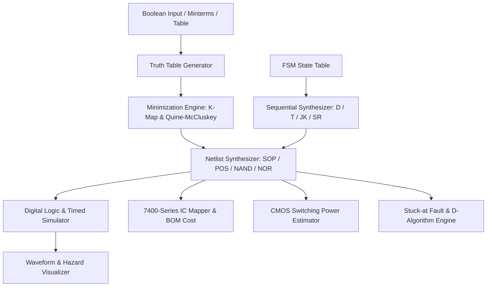

# LDAM System Architecture & Data Flow

## 1. High-Level System Overview

The **Logic Design & Applications (LDAM) Circuit Analyzer** is an educational, full-stack digital logic synthesis, analysis, and simulation workbench. It bridges conceptual Boolean theory with real-world IC hardware realization.

---

## 2. Core Architecture Invariants

1. **Pure TypeScript Engine (`src/engine/`):**
   - No React, no DOM, no network calls, no randomness.
   - Fully deterministic and runnable in plain Node.js / Web Worker environments.
   - Re-usable for command-line verification and headless unit tests.

2. **Single Source of Truth Contracts (`src/engine/types.ts`):**
   - Inter-module communication strictly relies on explicit contracts: `Expr`, `TruthTable`, `Implicant`, `MinResult`, `Netlist`, `StateTable`, `Waveform`, `CostReport`, `PowerReport`, `FaultReport`.
   - All circuit consumers (Simulators, IC Mapper, Power Estimator, Fault Tester) read the identical `Netlist` format.

3. **Step-by-Step Pedagogical Transparency:**
   - Every reduction, grouping, and excitation derivation produces structured `Step[]` data.
   - Consumed by both the interactive UI steppers and the AI Study Assistant.

---

## 3. Technology Stack & Mandated Library Rationale

| Library | Role | Rationale |
|---|---|---|
| **Vite + React 19 + TypeScript (Strict)** | Core Framework | Ultra-fast HMR, strict type safety, zero runtime overhead for modern Web Standards. |
| **Zustand** | Global State Management | Lightweight, hook-based, zero boilerplate provider nesting. Decouples state slices across input, minimization, synthesis, sequential, and analysis pipelines. |
| **Zundo** | Undo / Redo History | First-class temporal history for circuit manipulations and state-table editing. |
| **Comlink** | Web Worker Offloading | Offloads exponential algorithms (Petrick's expansion for 6–8 vars, complete fault vector generation, long timing runs) off the UI main thread to maintain 60 FPS responsiveness. |
| **@xyflow/react & elkjs** | Circuit & State Diagram Layout | Industry-standard directed graph visualization, handling complex gate-level orthogonal wiring, zoom/pan navigation, and minimaps without ad-hoc SVG spaghetti code. |
| **React Router v7** | Deep-linking & Design Persistence | URL-addressable module views (`/input`, `/kmap`, `/circuit`, `/sequential`, etc.) facilitating design sharing and reproducible testing. |
| **Vitest** | Unit & Golden Test Runner | Native Vite test runner with sub-second execution speed and compatibility with Jest DOM expectations. |
