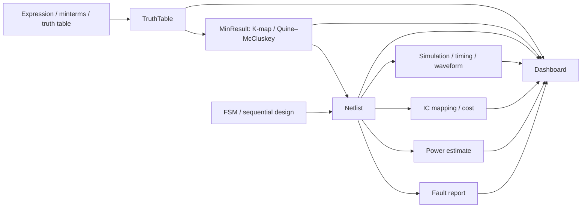

# Aletheia Project Guide

Aletheia is an educational workbench for **Logic Design and Microprocessor (LDAM)** coursework. The course acronym identifies the subject, not the application.

## Workflow

1. Enter a Boolean expression, minterms/maxterms, or an editable truth table in **Boolean Input**.
2. Review canonical forms and rows in **Truth Table**.
3. Compare Karnaugh-map grouping and Quine–McCluskey minimization in **K-Map & QM**. QM supports up to eight variables; K-map display is limited to five.
4. Synthesize and verify a circuit in **Circuit Schematic**, including NAND-only and NOR-only variants.
5. Explore **Sequential / FSM**, **Timing & Hazards**, **IC Cost & Power**, and **Fault Testing**.
6. Use the **Dashboard** to load an example, review results, save/load a project JSON file, or export a printable report.
7. Run **System Self-Test** for deterministic checks, or use the **Concept Guide** to find a topic’s page.

Cost, power, and transistor values are estimates based on the selected library and displayed assumptions. The AI Study Assistant is optional; its answers are advisory and do not replace deterministic engine results.

## Architecture

The TypeScript engine in `src/engine/` is deterministic and independent of React and the DOM. Engine modules share the contracts in `src/engine/types.ts`; circuit simulation, IC mapping, power estimation, and fault testing consume the same `Netlist`. The UI in `src/ui/` renders engine results and the Zustand store shares the active design across pages. Comlink delegates larger minimization and fault-analysis tasks to `src/workers/engine.worker.ts`.

The optional AI path is separate from the core engine: the browser sends a compact design context to the local Express `/api/chat` endpoint, and the server calls Gemini using a key held in `server/.env`.

## Course-topic map

| Topic | Workbench page | Main implementation |
|---|---|---|
| Boolean syntax, parsing, evaluation | Boolean Input | `src/engine/boolean/` |
| Minterms, maxterms, truth tables, canonical forms | Boolean Input; Truth Table | `src/engine/boolean/truth-table.ts`, `canonical.ts` |
| Boolean algebraic reduction | Boolean Input | `src/engine/boolean/algebraic.ts` |
| Karnaugh maps and Quine–McCluskey | K-Map & QM | `src/engine/minimize/kmap.ts`, `qm.ts` |
| Multi-output minimization | K-Map & QM | `src/engine/minimize/multi-qm.ts` |
| Gate synthesis, simulation, equivalence | Circuit Schematic | `src/engine/circuit/` |
| MSI blocks | Circuit Schematic | `src/engine/circuit/blocks.ts` |
| Flip-flops, counters, FSMs | Sequential / FSM | `src/engine/sequential/` |
| Timing, propagation delay, hazards | Timing & Hazards | `src/engine/timing/` |
| IC mapping and cost | IC Cost & Power | `src/engine/analysis/ic-map.ts`, `src/data/ic-library.json` |
| Power estimates | IC Cost & Power | `src/engine/analysis/power.ts` |
| Stuck-at faults and test vectors | Fault Testing | `src/engine/analysis/fault.ts` |
| Project summary and export | Dashboard | `src/ui/pages/DashboardPage.tsx`, `src/store/project.ts` |
| Deterministic diagnostic checks | System Self-Test | `src/ui/selfTest.ts` |
| Context-aware tutoring | AI Assistant | `src/ui/buildContext.ts`, `server/` |

## Projects and browser storage

The Dashboard downloads and loads versioned project JSON. It also keeps a debounced copy of the current design in browser local storage; clearing site data removes that session copy. Project files contain design data, not API credentials. The JSON envelope retains the legacy `ldam-project` identifier so projects created before the Aletheia rebrand remain readable.

## Portability and source sharing

There are no machine-specific absolute paths in the application. Build and development paths are resolved relative to the repository; the Vite proxy and optional API server use local loopback addresses and configurable ports. To run on another computer, copy the repository, install Node.js and pnpm, run `pnpm install`, then start the frontend with `pnpm dev`. Start `pnpm server:dev` as well only when using the AI assistant.

For a source ZIP, omit `.git`, `node_modules`, `dist`, `.aider*`, and any real `server/.env`. Keep `server/.env.example` as the configuration template.
